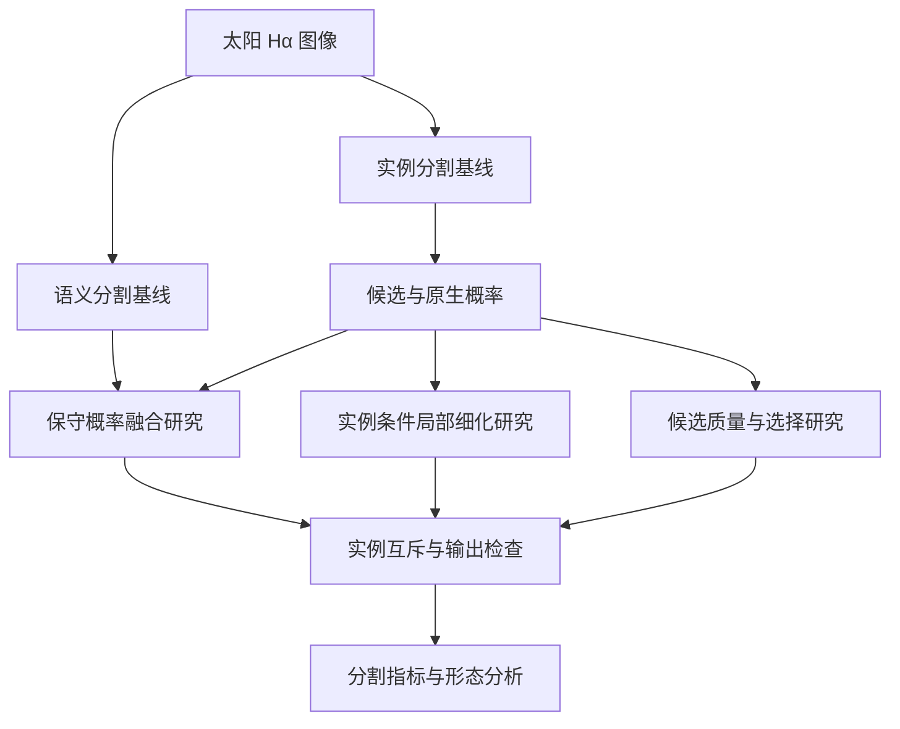

# Solar Filament Segmentation

### 太阳暗条实例分割研究

**从候选检测到原生分辨率细化，探索细长结构的完整分割。**

[English](README.en.md) · [研究路线](docs/research-route.md) · [关键技术](docs/technical-overview.md)

本项目面向太阳 Hα 图像中的暗条实例分割，研究如何识别不同暗条、保留细长边界与连接关系，并处理多份人工标注之间的差异。工作覆盖模型基线、受控消融、候选误差分析、局部细化和实验复现。

这里是项目的公开介绍，展示研究思路与已开展的工作。仓库仅包含介绍文档和方法示意，不提供数据集、样本图、标注、模型权重、实验结果文件或训练实现。

## 我们关心的问题

| 问题 | 研究重点 |
|---|---|
| 细小、细长结构容易遗漏 | 比较输入尺度、候选覆盖和局部细化 |
| 相邻实例容易竞争或混合 | 检查实例归属、重叠处理与候选选择 |
| 更高分数未必意味着更完整的形态 | 同时观察匹配质量、误检漏检、断裂和边界侵蚀 |
| 多份标注存在分歧 | 保留各套标注，研究冲突区域的监督处理 |
| 研究结果需要能够追溯 | 记录配置、模型来源、数据划分、失败与恢复过程 |

## 方法概览

项目先建立实例分割和语义分割两条基线，再分别研究保守融合、实例条件细化和候选质量。下图概括研究方向；不同分支分别评估，并非全部叠加成一个最终模型。

## 已开展的工作

- **基线与分辨率消融**：比较实例路线与语义裁块路线，检查输入尺度和ROI掩膜网格的影响。
- **保守融合**：研究匹配实例之间的概率融合，同时检查新增损伤和运行成本。
- **原生分辨率细化**：结合图像与实例概率进行局部修正，重点分析边界、细枝和连接关系。
- **多标注监督**：探索专家标注冲突区域的负监督屏蔽，保留原有正例。
- **候选质量与交叉拟合**：分析候选存在但未被选中的情况，检查特征、排序目标和训练来源隔离。
- **可靠实验工程**：维护评测一致性、断点恢复、缓存复用、数值等价与归档核验。

## 阶段认识

高分辨率、保守融合和原生细化在部分开发对照中呈现正向信号，但收益需要连同误检、形态变化及计算成本解释。更高分辨率、更多候选或更复杂的质量评分，并不保证最终分割更好。

项目同时保留负结果：有些方法改善了局部召回或校准，却没有改善完整输出；部分连接修补也带来了新的形态风险。这些结果用于收敛研究方向，而不是只展示最有利的案例。

上述认识来自项目内部研究，不代表独立盲测结论、排行榜领先或已发表成果。详细数值与研究证据仍在内部整理，当前公开内容不作成绩声明。

## 技术方向

`Python` · `PyTorch / torchvision` · `Mask R-CNN` · `语义分割` · `实例条件细化` · `COCO RLE` · `时间分组验证` · `交叉拟合`

## 当前进展

截至 **2026年11月7日**，项目已完成多轮基线、消融与误差诊断，已建立统一的实验资料整理流程。后续重点是收敛方法、补充形态评价和完成研究文稿。

这份展示会随经核实的研究进展更新。方法脉络见[研究路线](docs/research-route.md)，实现思路见[关键技术](docs/technical-overview.md)。
